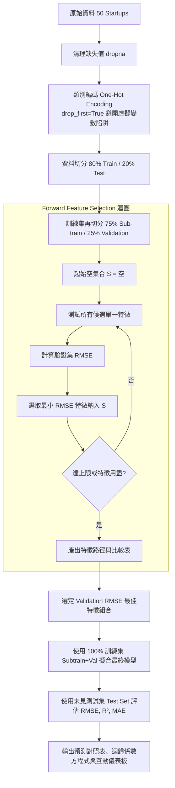

# Forward Selection ML Workflow & Skill Guide

本 Skill 規範了使用前向逐步特徵選取（Forward Stepwise Selection）進行多元線性迴歸（Multiple Linear Regression, MLR）的標準作業程序與工程實踐。

---

## 核心設計理念與架構

前向逐步特徵選取是一種由簡單到複雜的貪婪（Greedy）演算法：
1. **初始狀態**：特徵集合為空 $\mathcal{S} = \emptyset$。
2. **反覆疊代**：在每一輪中，從尚未選取的剩餘特徵集合中挑選一個加入候選集，使得新模型在**獨立驗證集（Validation Set）**上的誤差指標（如 RMSE）達到最低（或 $R^2$ 達到最高）。
3. **終止條件**：達到設定之最大特徵數 $K_{\max}$ 或誤差不再改善。
4. **模型重訓**：鎖定最佳特徵子集後，利用**完整訓練集（Sub-train + Validation）**重新擬合最終權重 $\boldsymbol{\beta}$。
5. **最終評估**：僅在從未見過的**獨立測試集（Test Set）**上評估泛化能力，防止資訊洩漏（Data Leakage）。



---

## 五大標準階段 (Workflow Stages)

### 階段 1：資料取得與健全性檢查 (Data Ingestion & Integrity)
- **遠端與本機雙重備援**：優先由雲端來源（如 GitHub Gist）抓取，若網路離線或超時，自動降級載入本機快取 `50_Startups.csv`。
- **欄位契約驗證**：強制檢查是否具備 `["R&D Spend", "Administration", "Marketing Spend", "State", "Profit"]`。
- **缺失值處理**：清理空值列。

### 階段 2：特徵工程與嚴格分割 (Feature Isolation)
- **虛擬變數陷阱防範 (Dummy Variable Trap)**：
  對州別 `State` 進行 One-Hot 編碼時，必須設定 `drop_first=True`，避免完全共線性（Multicollinearity）。
- **三向分割 (Three-way Split)**：
  - **測試集 (Test Set, 20%)**：全流程完全隔離，直至最終步驟才能進行單次預測評估。
  - **子訓練集 (Sub-train, 60% of total)**：供特徵搜尋期間擬合候選線性模型。
  - **驗證集 (Validation, 20% of total)**：供評分候選特徵，作為貪婪選取的客觀依據。

### 階段 3：逐步前向搜尋 (Greedy Forward Selection)
- 逐輪搜尋：
  $$\mathcal{F}^* = \arg\min_{f \in \mathcal{U}} \text{RMSE}_{\text{val}}\left(\mathcal{M}(\mathcal{S} \cup \{f\})\right)$$
- 記錄每輪候選特徵之驗證集 RMSE 與 $R^2$ 變化軌跡。

### 階段 4：全訓練集重新配適 (Refitting & Coefficients)
- 取驗證集 RMSE 最小之一組特徵 $\mathcal{S}^*$。
- 使用合併後的完整訓練集（Sub-train + Validation = 40 筆）配適最終模型：
  $$\hat{y} = \beta_0 + \sum_{j \in \mathcal{S}^*} \beta_j X_j$$

### 階段 5：泛化測試與推論交付 (Evaluation & Deployment)
- 計算測試集指標：
  - $\text{RMSE} = \sqrt{\frac{1}{n_{\text{test}}} \sum (y_i - \hat{y}_i)^2}$
  - $R^2 = 1 - \frac{\sum (y_i - \hat{y}_i)^2}{\sum (y_i - \bar{y})^2}$
  - $\text{MAE} = \frac{1}{n_{\text{test}}} \sum |y_i - \hat{y}_i|$
- 匯出預測成果檔 `test_predictions.csv` 及指標摘要 `results_summary.json`。
- 啟動/更新網頁端互動儀表板 `forward_selection.html`。

---

## 執行命令與工具整合

### 1. 執行 Python 批次腳本
```powershell
python forward_selection.py
```
執行後自動輸出：
1. Markdown 格式的前向選取進程表
2. 最佳特徵組合及其迴歸係數方程式
3. 測試集評估指標與預測殘差表
4. 本地報告 `test_predictions.csv` 與 `results_summary.json`

### 2. 開啟互動式視覺化網站
直接在瀏覽器中開啟 `forward_selection.html`：
- 動態前向選取逐步動畫與候選特徵條狀評比
- RMSE 與 $R^2$ 趨勢收斂折線圖
- 測試集 Actual vs Predicted 散佈圖與對角理想擬合線
- **即時獲利試算器（What-If Simulator）**：拖曳研發、行銷、行政經費，即時試算預估利潤與變數貢獻度！
- **特徵自由組合實驗室（Feature Playground）**：手動開關任一特徵，實時對比 Forward Selection 最優解。
