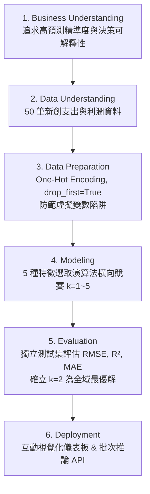

# 50 Startups Multiple Linear Regression Explorer 📈
### CRISP-DM Feature Selection & Parsimony Analysis Platform (Midnight Deep Blue Edition)

[](https://www.python.org/)
[](https://scikit-learn.org/)
[]()
[]()
[](LICENSE)
[](https://huanchen1107.github.io/AIoT-DIC2-MultipleLR/)

> 一個以 **CRISP-DM** 規範為基礎的多元線性迴歸（Multiple Linear Regression, MLR）特徵選取與模型簡約性（Parsimony Analysis）互動視覺化平台。全面對比 **5 種機器學習特徵選取演算法**（Lasso, Forward SFS, RFE, ElasticNet, Exhaustive Search），實證奧坎剃刀原則（Occam's Razor）——鎖定 **2 個特徵的最佳甜蜜點（Sweet Spot）**，並揭示 5 個全特徵的**過擬合懸崖（Overfitting Cliff）**。
>
> 🌌 **全新升級：深藍星空科技風 (Midnight Deep Blue)**——結合曜石海軍星空微光漸層、晶透毛玻璃卡片（Glassmorphism）與全域最優解翡翠綠霓虹高光，呈現專業高階研發儀表板體驗。

---

## 🌟 核心成果與視覺化儀表板 (Key Findings & Dashboard)

- 🔗 **線上互動體驗網址**：[https://huanchen1107.github.io/AIoT-DIC2-MultipleLR/](https://huanchen1107.github.io/AIoT-DIC2-MultipleLR/)

### 📌 關鍵數據摘要 (Benchmark Highlights)
- **全域最優模型 (Global Sweet Spot)**：$k = 2$（`R&D Spend` + `Marketing Spend`）
  - **Test RMSE**：**$8,198.80**（全特徵組合中泛化誤差最低）
  - **Test $R^2$**：**0.9474**（解釋 94.74% 的利潤變異度）
  - **Adjusted $R^2$**：**0.9324**
  - **Test MAE**：**$6,886.59**
  - **F-Statistic**：**349.0** ($P < 0.0001$，統計顯著度極高)
- **過擬合警訊 (Overfitting Warning)**：$k = 5$（Full Model）
  - 加入 `Administration` 與 `State` 後，測試集 RMSE 攀升至 **$9,137.99**（誤差增加 +$939.19），Adjusted $R^2$ 驟降至 **0.8531**。

---

## 🎨 深藍星空科技風 (Midnight Deep Blue UI Design)

本專案儀表板經過精心設計，提供現代高階資料科學視覺化體驗：
1. **曜石海軍星空漸層 (Celestial Mesh Gradient)**：底色採用 `#070b14` ~ `#0b1224` 深曜黑曜石星空，疊加多層微弱星雲光暈。
2. **毛玻璃晶透層次 (Cosmic Glassmorphism)**：卡片具備 `rgba(13, 22, 42, 0.76)` 半透明深藍質地與 `backdrop-filter: blur(16px)`，搭配細緻霓虹微光邊框（`rgba(99, 102, 241, 0.2)`）。
3. **高對比狀態霓虹高光 (Neon State Accents)**：
   - **最佳甜蜜點 ($k=2$)**：高顯色度**翡翠綠光澤**（`#34d399` / `#10b981`），在按鈕、評比表格高亮列與核心指標卡片中突出顯示。
   - **過擬合警示 ($k=5$)**：呈現**琥珀星火光澤**（`#fbbf24`）。
   - **演算法按鈕**：選取時呈現**靛藍星輝**（`#818cf8`）與動態位移懸浮回饋。
4. **Chart.js 深度深色適配**：圖表格線細膩通透（`rgba(255, 255, 255, 0.07)`），文字刻度與 Tooltip 均採用深色半透毛玻璃浮層。
5. **現代高階字體**：標題採用 Google Fonts **Outfit**、內文為 **Inter**、數值與方程式為 **JetBrains Mono**。

---

## 📊 5 種演算法特徵挑選橫向評比 (5-Method Benchmark)

在嚴格隔離的 20% 未見測試集（Test Set, $N=10$, `random_state=0`）上進行盲測評估：

| 特徵選取演算法 (Algorithm) | k=1 (RMSE) | k=2 (Sweet Spot) | k=3 (RMSE) | k=4 (RMSE) | k=5 (Overfitting) | 最優特徵數 | 最佳 Test RMSE |
| :--- | :---: | :---: | :---: | :---: | :---: | :---: | :---: |
| **Lasso (L1 Regularization)** | $8,274.87 | **$8,198.80 ★** | $8,309.06 | $8,409.92 | $9,137.99 ▲ | **k=2** | **$8,198.80** |
| **Forward SFS (Greedy)** | $8,274.87 | **$8,198.80 ★** | $8,803.78 | $9,068.54 | $9,137.99 ▲ | **k=2** | **$8,198.80** |
| **RFE (Backward Elimination)** | $41,366.02 | $39,655.93 | $8,219.81 | $8,409.92 | $9,137.99 ▲ | **k=3** | $8,219.81 |
| **ElasticNet (L1 + L2)** | $8,274.87 | **$8,198.80 ★** | $8,309.06 | $8,409.92 | $9,137.99 ▲ | **k=2** | **$8,198.80** |
| **Exhaustive (Best Subset)** | $8,274.87 | **$8,198.80 ★** | $8,803.78 | $9,068.54 | $9,137.99 ▲ | **k=2** | **$8,198.80** |

> **統計結論**：Lasso、Forward SFS、ElasticNet 與 Exhaustive Search（全子集搜尋）高度共識指向 $k=2$，證明 **研發支出（R&D Spend）** 與 **行銷費用（Marketing Spend）** 是驅動新創獲利的最核心關鍵因子。

---

## 📐 最佳配適迴歸方程式 (Fitted MLR Equation)

依據 $k=2$ 最優特徵子集，在完整訓練集（40 筆樣本）上訓練之最小平方法（OLS）方程式：

$$\widehat{\text{Profit}} = 46,346.34 + 0.7886 \times (\text{R\&D Spend}) + 0.0326 \times (\text{Marketing Spend})$$

- **截距 ($\beta_0 = \$46,346.34$)**：在新創公司研發與行銷投入為零時的基準估計利潤。
- **研發支出權重 ($\beta_1 = 0.7886$)**：每投入 \$1.00 美元研發經費，預期帶動約 \$0.79 美元之年利潤增長。
- **行銷推廣權重 ($\beta_2 = 0.0326$)**：每投入 \$1.00 美元行銷預算，預期貢獻約 \$0.033 美元邊際利潤。

---

## 🚀 互動式網頁功能特色 (Web Dashboard Features)

1. **五大特徵選取演算法即時切換**：
   - 點擊按鈕切換 **Lasso**、**Forward SFS**、**RFE**、**ElasticNet** 與 **Exhaustive Search**，即時重繪特徵路徑與指標。
2. **動態特徵數選擇器 ($k=1 \dots 5$)**：
   - 即時響應 **TEST RMSE**、**$R^2$**、**Adjusted $R^2$**、**MAE** 與 **F-Statistic** 五大核心指標卡片。
3. **偏差-方差權衡與模型簡約曲線 (Bias-Variance Tradeoff Curves)**：
   - 視覺化呈現隨特徵數增加，模型從欠擬合（$k=1$）、到達最佳泛化平衡（$k=2$），再到過擬合懸崖（$k=5$）的 U 型誤差軌跡。
4. **即時獲利預測模擬器 (Interactive What-If Profit Simulator)**：
   - 拖曳研發、行銷、行政支出滑桿與州別選單，即時計算預估利潤並拆解變數貢獻度（Waterfall Attribution）。
   - 內建一鍵情境預設：「🚀 獨角獸擴張型」、「⚖️ 資料集平均水準」、「🌱 精實啟動型」。
5. **未見測試集殘差診斷 (Holdout Test Predictions & Residuals)**：
   - 散佈圖比對實際值 vs. 預測值與 $y = \hat{y}$ 理想對角線，點擊檢視個別新創公司之預測殘差與誤差百分比。
6. **完整 50 筆原始資料集即時檢索 (Data Explorer)**：
   - 支援關鍵字過濾搜尋與訓練集/測試集標籤標記。
7. **CRISP-DM 完整方法學互動彈窗 (Modal)**：
   - 深入解說從商業理解、資料前處理至模型部屬的 6 大生命週期階段。

---

## 🛠️ CRISP-DM 標準方法學落實 (CRISP-DM Workflow)



### 虛擬變數陷阱防範 (Dummy Variable Trap Prevention)
資料集中州別 `State` 包含 3 個類別（New York, California, Florida）。採用 One-Hot Encoding 時，必須設定 `drop_first=True` 移除 California 作為基準組：
$$\sum_{i=1}^3 D_i = 1 \implies D_{\text{Cal}} + D_{\text{FL}} + D_{\text{NY}} = 1$$
若不剔除基準組，虛擬變數之和將與常數項（Intercept）形成完全共線性（Perfect Multicollinearity），使矩陣 $(X^T X)$ 不可逆，導致迴歸係數估計失真。

---

## 💻 快速開始 (Quick Start)

### 1. 安裝環境依賴 (Prerequisites)
確保已安裝 Python 3.9+，執行以下指令安裝套件：
```bash
pip install -r requirements.txt
```

### 2. 執行 Python 分析管線 (Run ML Pipeline)
執行端到端特徵選取與評估腳本：
```bash
python forward_selection.py
```
執行後將在終端輸出特徵路徑比較表，並自動生成：
- `test_predictions.csv`：測試集預測殘差對照表。
- `results_summary.json`：全域最佳模型方程式與評估指標。
- `model_data.json`：供前端視覺化儀表板使用的完整預先計算資料包。

### 3. 生成或重新編譯前端儀表板 (Generate HTML Dashboard)
```bash
python generate_html.py
```

### 4. 開啟互動儀表板 (Launch Interactive Dashboard)
- **方法一**：直接雙擊開啟 `index.html` 或 `forward_selection.html`。
- **方法二**：啟動輕量本地 Web 伺服器：
  ```bash
  python -m http.server 8080
  ```
  在瀏覽器中開啟 [http://localhost:8080](http://localhost:8080) 即可體驗完整功能。

---

## 📂 專案結構 (Directory Structure)

```text
DIC2/
├── index.html                 # 互動式儀表板首頁 (支援 GitHub Pages 根目錄部署)
├── forward_selection.html     # 50 Startups MLR 互動分析儀表板
├── forward_selection.py       # CRISP-DM 端到端特徵選取與迴歸推論腳本
├── 50_Startups.csv            # 50 筆新創公司原始資料集快取
├── generate_html.py           # 儀表板 HTML 與 Chart.js 構建腳本 (深藍星空主題)
├── model_data.json            # 5 種演算法與評估指標 JSON 資料包
├── test_predictions.csv       # 測試集預測殘差匯出檔
├── results_summary.json       # 最佳模型摘要 JSON 檔
├── requirements.txt           # Python 依賴清單
├── .gitignore                 # Git 忽略設定
└── README.md                  # 專案詳細文件說明
```

---

## 🌐 部署至 GitHub Pages (GitHub Pages Deployment)

1. 將本專案 Push 至 GitHub 倉庫的 `main` 分支。
2. 前往 GitHub 倉庫的 **Settings** -> **Pages**。
3. 在 **Build and deployment** 下方的 **Source** 選擇 `Deploy from a branch`。
4. **Branch** 選擇 `main`，資料夾選擇 `/ (root)`，點擊 **Save**。
5. 稍候數分鐘即可透過 `https://<your-username>.github.io/<repo-name>/` 線上存取互動儀表板！

---

## 📜 授權協議 (License)

本專案基於 [MIT License](LICENSE) 開源授權。
